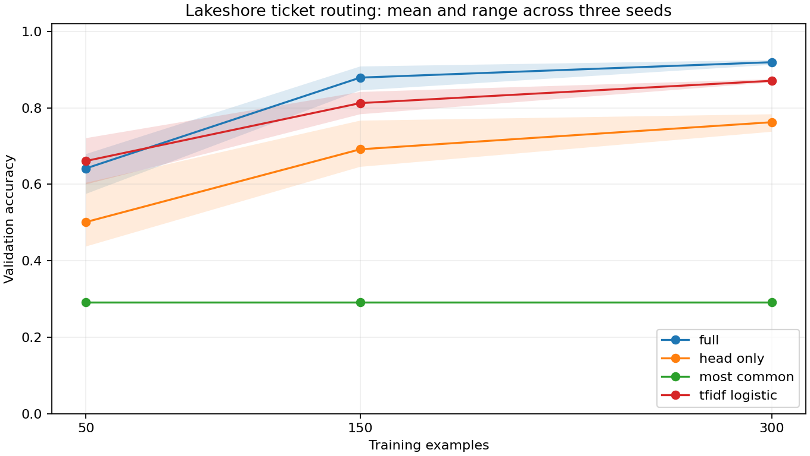

# Lakeshore Ticket Sorter: fine-tuning against a baseline

- [Live demo — Hugging Face Space](https://huggingface.co/spaces/SafaaAlhawasli/lab09-ticket-sorter)
- [Trained model and model card](https://huggingface.co/SafaaAlhawasli/lab09-ticket-sorter-model)

## What it does

The app suggests a support queue for short English bike-share messages. It shows
a score for billing, bike faults, stations, and accounts, along with the
suggested queue. It also handles empty input.

## How to run it

With Git and Conda installed, open Anaconda Prompt on Windows in the folder
where you want the project. Run the commands below in order. The environment
uses Python 3.12, and each Python command uses that named environment directly.

```bash
git clone https://github.com/safi111287/lab09-fine-tune-and-publish.git lab09-fine-tune-and-publish-test
cd lab09-fine-tune-and-publish-test
conda env create -f environment.yml
conda activate lab09-fine-tune-and-publish
conda run --no-capture-output -n lab09-fine-tune-and-publish python -m pip install -r requirements-dev.txt
conda run -n lab09-fine-tune-and-publish python -c "import torch; print(torch.__version__)"
conda run -n lab09-fine-tune-and-publish python -m ruff format --check .
conda run -n lab09-fine-tune-and-publish python -m ruff check .
conda run -n lab09-fine-tune-and-publish python -m pytest
conda run --no-capture-output -n lab09-fine-tune-and-publish python run_experiments.py
conda run --no-capture-output -n lab09-fine-tune-and-publish python app.py
```

If the environment already exists, replace the `conda env create` line with
`conda env update -n lab09-fine-tune-and-publish -f environment.yml`.
The explicit pip command checks the pinned dependencies in that environment.
`requirements-dev.txt` includes `requirements.txt`, so one pip command covers
both the runtime and test dependencies.

The first experiment run downloads DistilBERT. The full run uses the 40
independent messages in `data/own_messages.csv`, writes the results to
`reports/`, and saves the selected checkpoint, tokenizer, and model card in
the ignored `model/` folder. When the demo starts, open the local URL printed
in the terminal.

## Data and split

The unchanged `tickets_data.py` generates 1,200 invented messages.
A fixed split seed (2026) assigns tickets by ID to 720 training, 240 validation,
and 240 test rows. Splitting and sampling preserve the class proportions as
closely as row counts allow. Ticket IDs and labels are not model inputs.

## Methods

All four methods use the same training rows at each size (50, 150, and 300)
and seed (11, 22, and 33). Each run uses the same validation split. The
baselines are majority class and unigram/bigram TF-IDF with logistic regression.
TF-IDF is fitted on each training sample.

For DistilBERT, head-only training updates the pre-classifier and classifier at a
learning rate of 0.001; full fine-tuning updates the entire network at 0.00005.
AdamW runs for up to four epochs. Text is truncated at 64 tokens and padded only
to the longest item in each batch. For each size and variant, the selected epoch
has the highest mean validation accuracy across the seeds (earliest on a tie).
The demo uses the better DistilBERT variant at 300 rows, with seed 22 fixed in
advance for held-out evaluation. Both baselines use those same 300 training
rows for the final comparison.

## Results

Validation accuracy at the selected epoch for each size and method:

| Training rows | Method | Mean accuracy | Seed range |
| ---: | --- | ---: | ---: |
| 50 | DistilBERT full | 64.2% | 57.5%–67.9% |
| 50 | DistilBERT head only | 50.1% | 43.8%–60.4% |
| 50 | Majority class | 29.2% | 29.2%–29.2% |
| 50 | TF-IDF + logistic | 66.1% | 60.0%–72.1% |
| 150 | DistilBERT full | 87.9% | 84.6%–90.8% |
| 150 | DistilBERT head only | 69.2% | 64.6%–76.7% |
| 150 | Majority class | 29.2% | 29.2%–29.2% |
| 150 | TF-IDF + logistic | 81.2% | 78.3%–84.2% |
| 300 | DistilBERT full | 91.9% | 91.2%–92.5% |
| 300 | DistilBERT head only | 76.2% | 73.8%–78.3% |
| 300 | Majority class | 29.2% | 29.2%–29.2% |
| 300 | TF-IDF + logistic | 87.1% | 86.7%–87.5% |



| Method | Test accuracy | Test macro F1 |
| --- | ---: | ---: |
| DistilBERT full | 90.0% | 0.902 |
| Majority class | 28.7% | 0.112 |
| TF-IDF + logistic | 87.1% | 0.873 |

The [confusion matrix](reports/confusion_matrix.png) shows the selected DistilBERT
model on the 240 held-out tickets. See `reports/results.csv` for every
run, `reports/epochs.csv` for training loss, and `reports/final.json` for final scores.

## Your own 40 messages

This independent check uses ten messages per queue with the CSV columns `text`
and `label`. The messages are held out from all training and model selection.

The included CSV is an AI-assisted draft of fictional examples and was scored
separately after model selection. A small, balanced draft with clear categories
does not estimate performance on real customer traffic.

| Method | Draft accuracy | Draft macro F1 |
| --- | ---: | ---: |
| DistilBERT full | 97.5% | 0.975 |
| Majority class | 25.0% | 0.100 |
| TF-IDF + logistic | 85.0% | 0.845 |

## Publishing

The model repository and Gradio Space are separate Hugging Face repositories.
Authenticate locally with `hf auth login`. Run
`python publish.py --model-id OWNER/MODEL --space-id OWNER/SPACE` from the
project root to publish the weights, tokenizer, model card, and Space. For a PRO account, a public Gradio Space on CPU Basic is sufficient for this
app. The Space reads the Hub repository ID from its `MODEL` variable. To test that route locally
in PowerShell, run:

```powershell
$env:MODEL = "OWNER/MODEL"
python app.py
```

## Tests

The setup commands above run Ruff and pytest in the project environment.
The tests use a small DistilBERT configuration and an offline tokenizer to
verify model behavior without downloading the pretrained weights.

## Limitations

The generated messages repeat templates, and some are vague or mix topics.
The model assumes one English queue per ticket. The scores are not calibrated
probabilities of being correct. The classifier is designed to help a person
review a ticket, and has not been validated on real customer traffic.
